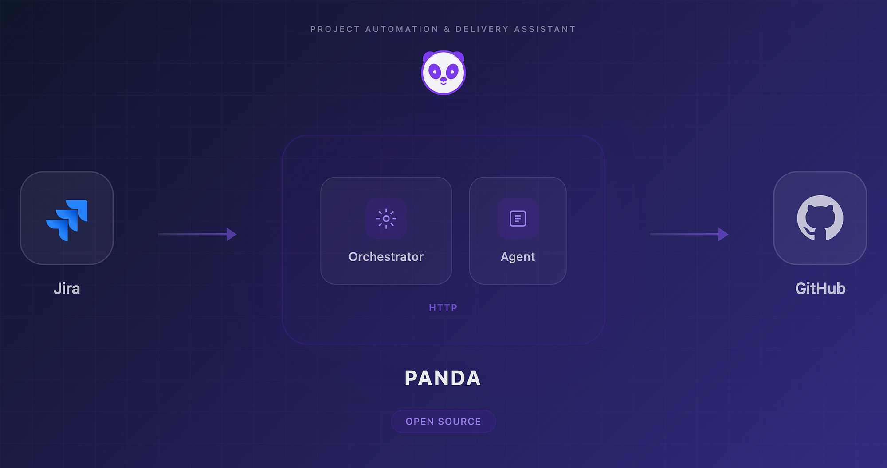
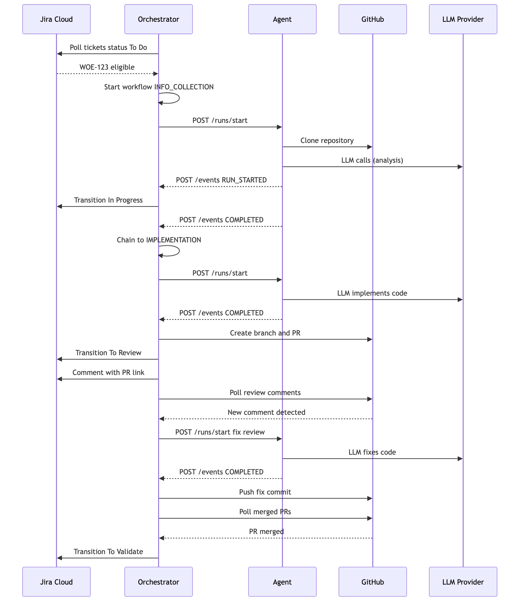

_Cet article a d'abord été publié en anglais sur le [blog Medium de la TotalEnergies Digital Factory](https://medium.com/totalenergies-digital-factory/our-ai-agent-does-not-write-code-it-ships-features-e5d679d67d71)._

> [!note] Mise à jour, novembre 2026
> Depuis la publication de cet article, PANDA a livré **plus de 400 tickets** et il est déployé dans **80 % des équipes** de la TotalEnergies Digital Factory.

Nous utilisons Jira pour les tickets, GitHub pour le versionnement et la revue de code, et des agents de code IA pour assister les développeurs. Une question a fini par s'imposer : et si l'on pouvait automatiser tout le cycle d'implémentation, de la prise en charge du ticket jusqu'au code livré ?

Cet article présente **PANDA** (_Project Automation & Delivery Assistant_), le système d'orchestration que nous avons construit pour y répondre. PANDA relie Jira, GitHub et un agent de code IA dans une chaîne de livraison continue qui fonctionne de façon autonome, tout en laissant aux humains le contrôle de la qualité.

## Le problème : du travail mécanique dans un processus créatif

Dans une équipe de développement, le cycle de vie d'un ticket suit un schéma prévisible :

<figure class="flow-figure">
  <ol class="ticket-flow" aria-label="Cycle de vie type d'un ticket">
    <li>Ticket créé</li>
    <li class="is-auto">Lecture du ticket</li>
    <li class="is-auto">Exploration du code</li>
    <li class="is-auto">Implémentation</li>
    <li class="is-auto">Push et PR</li>
    <li>Revue de code</li>
    <li class="is-auto">Correction des retours</li>
    <li>Merge</li>
    <li>Validation par le PO</li>
  </ol>
  <figcaption class="flow-legend">
    <i class="flow-key is-auto" aria-hidden="true"></i>Étape mécanique, confiable à un agent
    <i class="flow-key" aria-hidden="true"></i>Étape humaine
  </figcaption>
</figure>

Ce cycle représente **4 à 6 heures de travail effectif par ticket**. Or, quand le ticket est bien défini, la plupart de ces étapes sont mécaniques : lire une spécification claire, naviguer dans un code connu, appliquer un changement circonscrit, traiter des commentaires de revue.

La question n'est pas de savoir si un agent IA sait écrire du code : il le sait. Le vrai défi d'ingénierie est ailleurs : **peut-on orchestrer un agent pour qu'il gère tout le cycle de vie de manière fiable, en production, avec de vraies frontières de sécurité ?**

## Comment fonctionne PANDA

PANDA est un orchestrateur autonome qui fonctionne par **phases explicites**. Chaque phase a des conditions d'entrée et de sortie claires, et le système passe de l'une à l'autre en réagissant aux événements de Jira et de GitHub.

<figure>
  <video
    src="/media/panda/scenario-jira.mp4"
    poster="/media/panda/scenario-jira-poster.jpg"
    autoplay
    loop
    muted
    playsinline
    preload="metadata"
    aria-label="Un ticket Jira traverse les colonnes du tableau, de To Do à Done, piloté par PANDA"
  ></video>
  <figcaption>Un ticket traverse le tableau Jira, piloté par PANDA.</figcaption>
</figure>

### Phase 1 : prise en charge du ticket

L'orchestrateur interroge Jira en continu. Quand un ticket passe en « To Do », PANDA évalue son éligibilité. Les tickets au contexte insuffisant (description manquante, critères d'acceptation flous, périmètre ambigu) passent en « Blocked », avec un commentaire qui précise les informations manquantes.

Les tickets éligibles déclenchent la chaîne d'implémentation : l'orchestrateur clone les dépôts concernés, crée une branche de fonctionnalité et lance l'agent.

> PANDA gère les workflows **multi-dépôts**. Quand un ticket touche à la fois un service backend et une application frontend, l'agent travaille sur les deux bases de code et l'orchestrateur ouvre les pull requests correspondantes.

### Phase 2 : implémentation

L'agent reçoit le contexte du ticket et les dépôts récupérés. Il analyse le code existant, implémente la solution et signale qu'il a terminé. L'orchestrateur commite alors les changements, les pousse et ouvre les pull requests sur GitHub.

Une implémentation complexe sur plusieurs dépôts prend en général **une trentaine de minutes** (avec Claude Opus comme modèle).

### Phase 3 : validation technique

Un développeur relit la pull request. Dès que des commentaires de revue sont publiés, l'orchestrateur les détecte et relance l'agent sur la branche concernée. L'agent traite les retours et pousse ses corrections. Le cycle se répète jusqu'à l'approbation.

### Phase 4 : validation métier

Une fois la pull request mergée, le ticket passe automatiquement en « To Validate ». Si le product owner laisse un commentaire dans Jira, l'agent reprend le ticket, implémente les corrections et ouvre une nouvelle pull request.

### Phase 5 : terminé

Quand toutes les validations sont passées, le ticket atteint son état final.

## La séquence de bout en bout

Voici le flux complet, de la prise en charge du ticket à la livraison, avec les échanges entre l'orchestrateur, l'agent et les systèmes externes :

## Architecture : deux conteneurs, zéro confiance

La sécurité n'est pas négociable quand on donne à un agent IA un accès shell à du code de production. L'architecture de PANDA repose sur un principe unique : **l'agent ne manipule jamais les secrets des systèmes métier.**

### L'orchestrateur

L'orchestrateur détient tous les identifiants et gère chaque interaction avec les systèmes externes :

- **Surveillance** : il interroge en continu Jira et GitHub pour détecter les changements d'état.
- **Opérations Git** : clone, fetch, push, création de branches.
- **Identifiants** : il détient le jeton d'API Jira et la clé privée de la GitHub App.
- **Workflow** : il gère les transitions d'état et applique les délais maximaux.
- **Sûreté** : il détecte les exécutions bloquées et arrête les processus zombies au démarrage.

### L'agent

L'agent est volontairement bridé. Il peut écrire du code, et rien d'autre, pour se prémunir de toute injection de prompt malveillante cachée dans un ticket :

- **Identifiants** : il ne reçoit que la clé d'API du fournisseur de LLM.
- **Espace de travail** : il opère dans un volume partagé.
- **Communication** : uniquement des callbacks HTTP vers l'orchestrateur.

## Choix de conception : ce que PANDA ne fait volontairement pas

### Pas de revue de code automatisée

La validation technique reste humaine. PANDA accélère l'implémentation, mais il ne retire pas le contrôle sur ce qui part en production : chaque ligne de code générée est relue par un développeur avant le merge.

**Le goulot d'étranglement s'est déplacé.** Ce n'est plus la capacité d'implémentation, c'est la capacité à écrire des tickets bien définis et à relire les pull requests rapidement.

### Pas d'interprétation de l'ambiguïté

Un ticket mal décrit est un ticket bloqué. Plutôt que de deviner l'intention, l'orchestrateur repère les tickets inéligibles et demande explicitement les informations manquantes.

> La qualité du ticket détermine directement la qualité de l'implémentation. C'est voulu : cela pousse toute l'équipe à mieux rédiger ses tickets.

### Pas d'état persistant au-delà du système de fichiers

Il n'y a ni base de données ni file de messages durable. PANDA enregistre ses workflows dans des fichiers JSON et reconstruit son état à partir de Jira et de GitHub à chaque cycle. Le système résiste ainsi aux redémarrages, et toute une famille de bugs de synchronisation d'état disparaît.

## Ce qui améliore radicalement la qualité de l'implémentation

Le résultat de PANDA ne vaut que le contexte qu'il reçoit. Au-delà de tickets bien écrits, quelques documents au niveau du dépôt font une différence spectaculaire.

### AGENTS.md

Un fichier dédié, à la racine de chaque dépôt, qui explique à l'agent comment travailler dans cette base de code précise : conventions de code, règles de nommage, attentes en matière de tests, format des messages de commit et pièges courants.

Voyez-le comme une documentation d'onboarding, mais pour l'agent. Sans elle, il produit du code générique. Avec elle, le résultat respecte les standards de l'équipe.

### La documentation métier

Un document purement fonctionnel qui explique le contexte du domaine : ce que fait l'application, qui sont ses utilisateurs, quelles sont les règles métier essentielles et comment les fonctionnalités s'articulent. Il donne à l'agent le « pourquoi » du code. Sans lui, les implémentations sont techniquement correctes mais passent à côté des subtilités du métier.

### La documentation technique

Un document qui décrit l'architecture du système : comment les services interagissent, quels systèmes externes sont impliqués (API, bases de données, brokers de messages), la structure du projet et la topologie de déploiement. Il évite que l'agent fasse de mauvaises hypothèses sur l'endroit où le code doit vivre ou sur la façon dont les systèmes communiquent.

### L'effet cumulé

Pris séparément, chaque document aide. Ensemble, ils transforment l'agent : d'un générateur de code générique, il devient un outil qui comprend votre projet. L'effort investi dans ces documents est rentabilisé à chaque ticket traité.

## L'impact sur l'équipe

Depuis le déploiement de PANDA, le fonctionnement de notre équipe a changé. Les développeurs ne passent plus l'essentiel de leur temps sur des implémentations bien définies. Ils se concentrent sur ce qui demande un jugement humain :

| Avant PANDA                                              | Après PANDA                                                             |
| -------------------------------------------------------- | ----------------------------------------------------------------------- |
| Les devs passent l'essentiel de leur temps à implémenter | PANDA implémente, les devs se concentrent sur le travail à forte valeur |
| L'implémentation est le goulot d'étranglement            | La revue et la qualité des tickets deviennent le goulot                 |
| Le travail d'architecture est sans cesse repoussé        | Les devs ont du temps pour la conception                                |
| Le backlog grossit plus vite que la livraison            | Les tickets avancent en continu                                         |

## Limites actuelles et feuille de route

Aujourd'hui, PANDA traite les tickets un par un. Les prochaines évolutions :

- **Exécution parallèle** : traiter plusieurs tickets en même temps.
- **Validation avant la pull request** : lancer les suites de tests automatisés avant d'ouvrir la PR.

## En résumé

PANDA est un outil d'optimisation de la performance. Il accélère la phase d'implémentation, la plus longue et la plus mécanique du cycle de livraison. Mais comme tout outil, la qualité de son résultat dépend directement de ce qu'on lui donne.

Pour exploiter PANDA à son plein potentiel :

- **Des tickets bien structurés** : une description claire, des critères d'acceptation, un périmètre explicite.
- **Un AGENTS.md** : les conventions de code, les patterns du projet et les règles que l'agent doit suivre.
- **Une documentation métier** : le contexte du domaine, les règles métier et le glossaire.
- **Une documentation technique** : l'architecture, les interactions avec les systèmes externes, la structure du projet.
- **Une base de code cohérente** : un code propre et homogène, dont l'agent peut s'inspirer.

Meilleur est le contexte, meilleure est l'implémentation. **PANDA ne remplace pas le besoin de clarté : il le récompense.**

## Pour commencer

PANDA est open source et disponible sur GitHub : [github.com/Naofel-eal/PANDA](https://github.com/Naofel-eal/PANDA). Contributions, retours et questions sont les bienvenus.

Vous voulez mettre en place des agents IA comme PANDA dans votre équipe ? [Parlons-en](/contact/).
